# Pedro Henrique da Cruz Santos

  

  Desenvolvo aplicações web de ponta a ponta: interfaces, APIs, integrações e dados.

  
  
  

## Stack

### Frontend

  
  
  
  
  
  
  
  

### Backend, APIs e dados

  
  
  
  
  
  
  
  
  
  
  

### Ferramentas e plataforma

  
  
  
  

## Projetos em destaque

### [Seletto Marketplace](https://github.com/PHdaCruzSantos/seletto) · projeto pessoal de estudo

Projeto em desenvolvimento que uso para estudar arquitetura de microsserviços. Tem interfaces para comprador e vendedor, um API Gateway e serviços separados para autenticação, catálogo e vendas. É meu espaço para praticar integração entre aplicações, APIs, persistência e infraestrutura.

  
  
  
  
  
  
  
  

### Portfólio profissional

No [meu portfólio](https://phdacruzsantos.dev.br/) estão reunidos projetos, trajetória e formas de contato.

  
  
  
  

## Extensões de navegador

As duas extensões usam scraping executado no navegador para coletar informações nas páginas dos próprios sites, com interface em painel lateral.

### [MP Buscador](https://github.com/PHdaCruzSantos/buscador-extensao) · pesquisa e comparação de produtos

Pesquisa produtos em várias lojas a partir da aba atual e reúne preços e informações em um só lugar. O worker em segundo plano coordena as coletas, enquanto o painel lateral permite configurar fontes, consultar o histórico local e exportar resultados em PDF.

  
  
  
  
  

### [NewDrops](https://github.com/PHdaCruzSantos/newDrop-extensao) · lançamentos de sneakers

Extensão para Chrome e Edge que acompanha lançamentos de marcas como Nike e Fila. Faz scraping sob demanda nas páginas abertas, coordena as tarefas com um service worker e apresenta os drops no painel lateral, mantendo os dados no armazenamento local do navegador.

  
  
  
  

## Projetos acadêmicos

### [WorkLink · Catálogo de Serviços](https://github.com/PHdaCruzSantos/Trabalho-pratico-Web-1) · Web 1

Trabalho prático Full Stack para conectar clientes a profissionais autônomos locais. Clientes podem buscar por profissão e solicitar serviços; profissionais gerenciam perfil, portfólio e propostas recebidas. O sistema inclui autenticação JWT e autorização por tipo de usuário, avaliações e uma API REST separada da SPA.

  
  
  
  
  
  
  

### [Análise de Mídias Sociais · Políticos](https://github.com/PHdaCruzSantos/ams-politicos)

Projeto iniciado na disciplina de Análise de Mídias Sociais para estudar padrões de votação e conexões entre deputados a partir de dados da Câmara. O repositório evoluiu para um pipeline de dados com extração, cálculo de métricas de centralidade em grafos, visualizações e experimentos de aprendizado de máquina.

  
  
  
  
  
  
  

### [Sistema Imobiliário · Algoritmos e Estruturas de Dados](https://github.com/PHdaCruzSantos/TP_AED-s_2)

Aplicação desktop para cadastrar e relacionar imóveis, clientes e corretores. A interface permite comparar busca sequencial e binária, ordenar registros, alocar imóveis e registrar tempos de execução para observar o comportamento dos algoritmos.

  
  

### [Jogo multiplayer de desenho · Redes de Computadores](https://github.com/PHdaCruzSantos/TP-RedesDeComputadores-Gartic)

Projeto acadêmico de jogo de desenho e adivinhação em tempo real, inspirado no Gartic. Um servidor Node.js coordena jogadores, lobby, traços de desenho, palpites, rodadas e pontuação. A comunicação dos jogadores usa WebSocket; o projeto também inclui um servidor TCP e mensagens estruturadas em JSON.

  
  
  
  

## Métricas do GitHub

  
  
  

  <picture>
    <source media="(prefers-color-scheme: dark)" srcset="https://streak-stats.demolab.com?user=PHdaCruzSantos&amp;theme=dark&amp;hide_border=true&amp;locale=pt_BR">
    
  </picture>

  <a href="https://github.com/PHdaCruzSantos?tab=overview&amp;from=2021-01-01&amp;to=2026-12-31">Ver atividade e contribuições no perfil</a>

## 🎮 Modo jogo

Escolha uma rota para explorar: [Full Stack · Seletto](https://github.com/PHdaCruzSantos/seletto) · [Extensões · MP Buscador e NewDrops](https://github.com/PHdaCruzSantos/buscador-extensao) · [Redes e tempo real · jogo de desenho](https://github.com/PHdaCruzSantos/TP-RedesDeComputadores-Gartic) · [Abrir demo do Pac-Man](https://abozanona.github.io/pacman-contribution-graph/)

  <picture>
    <source media="(prefers-color-scheme: dark)" srcset="https://raw.githubusercontent.com/PHdaCruzSantos/PHdaCruzSantos/output/pacman-contribution-graph-dark.svg">
    <source media="(prefers-color-scheme: light)" srcset="https://raw.githubusercontent.com/PHdaCruzSantos/PHdaCruzSantos/output/pacman-contribution-graph.svg">
    
  </picture>

